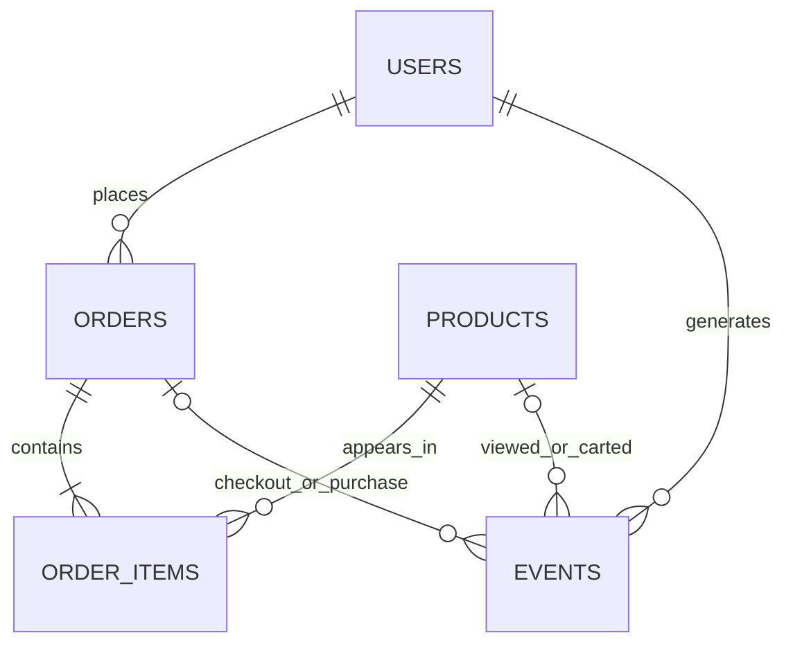

# Data Dictionary — Synthetic Product Analytics Dataset

## 1. Назначение

Набор данных моделирует работу вымышленного интернет-магазина за период **2026-01-01 — 2026-06-30 включительно**. Данные полностью синтетические; реальные персональные данные не используются. Генератор по умолчанию использует seed `42`.

Все временные метки сериализуются в ISO 8601 с суффиксом `Z` (UTC). Даты регистрации представлены в формате `YYYY-MM-DD`. CSV-файлы записываются в UTF-8.

## 2. Состав набора

- `users.csv` — пользователи и атрибуты привлечения.
- `products.csv` — каталог товаров и текущие цены.
- `orders.csv` — заказы и их статусы.
- `order_items.csv` — позиции заказов, количества и исторические цены.
- `events.csv` — события пользовательского поведения.
- `generation_report.json` — автоматически сформированный отчёт о количестве строк и статусах заказов.

Ожидаемый масштаб по умолчанию: 10 000 пользователей, 150 товаров, несколько тысяч заказов и десятки тысяч событий. Фактические размеры зависят от seed и поведенческой симуляции; точные значения записываются в отчёт.

## 3. Словарь полей

### `users.csv`

| Поле | Тип | Ключ | Описание |
|---|---|---|---|
| `user_id` | TEXT | PK | Синтетический уникальный идентификатор пользователя. |
| `registration_date` | DATE | — | Дата регистрации, включая первый календарный день, когда пользователь может проявить активность. |
| `acquisition_channel` | TEXT | — | Канал привлечения: `organic`, `paid_search`, `social`, `referral`, `email`. |
| `country` | TEXT | — | Синтетически назначенная страна пользователя. |
| `device_type` | TEXT | — | Тип устройства: `mobile`, `desktop`, `tablet`. |

### `products.csv`

| Поле | Тип | Ключ | Описание |
|---|---|---|---|
| `product_id` | TEXT | PK | Уникальный идентификатор товара. |
| `product_name` | TEXT | — | Синтетическое правдоподобное название товара. |
| `category` | TEXT | — | Одна из шести категорий каталога. |
| `price` | NUMERIC(10,2) | — | Текущая каталожная цена в условных денежных единицах (CU). Не является источником исторической цены заказа. |

### `orders.csv`

| Поле | Тип | Ключ | Описание |
|---|---|---|---|
| `order_id` | TEXT | PK | Уникальный идентификатор заказа. |
| `user_id` | TEXT | FK → `users.user_id` | Пользователь, создавший заказ. |
| `order_date` | TIMESTAMPTZ | — | Время оформления заказа в UTC. |
| `order_status` | TEXT | — | `completed`, `cancelled` или `returned`. |

### `order_items.csv`

| Поле | Тип | Ключ | Описание |
|---|---|---|---|
| `order_item_id` | TEXT | PK | Уникальный идентификатор строки позиции заказа. |
| `order_id` | TEXT | FK → `orders.order_id` | Заказ, к которому относится позиция. |
| `product_id` | TEXT | FK → `products.product_id` | Товар позиции. |
| `quantity` | INTEGER | — | Положительное целое количество единиц товара. |
| `unit_price` | NUMERIC(10,2) | — | Цена единицы товара, зафиксированная на момент оформления. |

В одном заказе товар встречается не более одного раза; количество отражается в `quantity`. Стоимость заказа рассчитывается как сумма `quantity * unit_price` по его позициям.

### `events.csv`

| Поле | Тип | Ключ | Описание |
|---|---|---|---|
| `event_id` | TEXT | PK | Уникальный идентификатор события. |
| `user_id` | TEXT | FK → `users.user_id` | Пользователь, совершивший событие. |
| `event_timestamp` | TIMESTAMPTZ | — | Время события в UTC. |
| `event_type` | TEXT | — | `view`, `add_to_cart`, `checkout` или `purchase`. |
| `product_id` | TEXT, nullable | FK → `products.product_id` | Товар для событий просмотра и добавления в корзину; `NULL` для событий уровня заказа. |
| `session_id` | TEXT | — | Идентификатор сессии. |
| `order_id` | TEXT, nullable | FK → `orders.order_id` | Дополнительное поле для явной связи событий `checkout` и `purchase` с заказом. Для прочих событий — `NULL`. |

`order_id` добавлен сверх минимальной схемы задачи намеренно: без него надёжно связать событие покупки с конкретным заказом существенно сложнее.

## 4. Связи между таблицами

- Один пользователь может иметь ноль, один или несколько заказов.
- Один заказ содержит одну или несколько уникальных товарных позиций.
- Товар может встречаться в разных заказах и пользовательских событиях.
- События связываются с пользователем и сессией; события оформления и покупки также связаны с заказом.

## 5. Бизнес-правила и допущения

### Статусы заказов

- `completed` — заказ успешно завершён.
- `cancelled` — заказ отменён; событие `purchase` для него не создаётся.
- `returned` — заказ был куплен, а затем возвращён. В событийной истории присутствует `purchase`, поскольку покупка изначально состоялась.

У каждого заказа есть ровно одно событие `checkout`. Для `completed` и `returned` есть ровно одно событие `purchase`; у `cancelled` такого события нет.

### Определение выручки

**Валовая выручка по завершённым заказам** = сумма `quantity * unit_price` по позициям заказов со статусом `completed`.

- Не включайте `cancelled` в продажи.
- Не включайте `returned` в базовую выручку по завершённым заказам.
- Не вычитайте возвраты отдельно: в наборе не моделируются дата возврата, частичный возврат, возврат денег, налоги, доставка и скидки.
- Не считайте число событий `purchase` денежной метрикой.
- Текущая цена `products.price` не должна использоваться вместо исторической `order_items.unit_price`.

### Сценарии поведения

- У пользователей есть скрытые индивидуальные параметры активности, покупательского намерения и склонности к повторным покупкам.
- Каналы привлечения умеренно влияют на частоту сессий и вероятности конверсии/возврата.
- Категории различаются по распространённости, а цены имеют разброс внутри категорий.
- Число регистраций меняется по дням и неделям.
- Вероятность активности зависит от доступного времени после регистрации.
- Сессии содержат последовательные просмотры; добавление в корзину, checkout и покупка происходят только при соответствующем переходе сценария.
- Заказы и события генерируются совместно. Время `purchase` позже времени `checkout`.
- Цены позиций могут немного отличаться от текущей цены каталога, моделируя исторические изменения цены.

## 6. Временные эффекты

Генератор включает умеренные неоднородности по времени, включая вариации в регистрации и активности. Эти эффекты нужны для практики анализа сезонности, когорт и динамики, но сами по себе не являются утверждениями о реальном рынке. В данных присутствуют также случайные колебания и различия пользовательских сегментов.

Чтобы не подсказывать результаты исследования, документация не фиксирует заранее, какие когорты или каналы должны показать лучшие показатели. Рекомендуется проверять устойчивость наблюдений и учитывать ограниченность синтетической симуляции.

## 7. Ограничения синтетических данных

- Поведение является моделью, а не эмпирическим описанием реального интернет-магазина.
- Каналы, страны, устройства и цены назначаются синтетически.
- Не моделируются маркетинговые расходы, показы рекламы, промокоды, налоги, доставка, остатки товара, платежные отказы как отдельные события, возврат денежных средств и частичные возвраты.
- Статус `returned` трактуется как заказ, который сначала был куплен; дата и сумма возврата не представлены.
- `checkout` соответствует созданию заказа, поэтому отдельные попытки checkout без созданного заказа не моделируются.
- Часовой пояс унифицирован в UTC; локальное время пользователя не моделируется.
- В датасете нет искусственно внесённых ошибок ссылочной целостности и намеренных дубликатов.

## 8. Проверки качества

Перед записью CSV скрипт проверяет:
- уникальность и заполненность первичных ключей;
- валидность внешних ключей;
- положительность цены и количества;
- отсутствие повторяющихся товаров внутри одного заказа;
- соответствие дат заказов и событий регистрации пользователей и заданному периоду;
- отсутствие повторяющихся сигнатур событий;
- наличие ровно одного `checkout` на заказ;
- согласованность событий `purchase` со статусами заказа;
- последовательность времени checkout → purchase;
- наличие позиций у каждого заказа;
- минимальный масштаб набора для когортного анализа.

Если проверка не проходит, скрипт завершится с ошибкой до сохранения файлов.

## 9. Рекомендуемые типы PostgreSQL

| CSV-поле | Тип PostgreSQL |
|---|---|
| Идентификаторы | `TEXT` |
| `registration_date` | `DATE` |
| `order_date`, `event_timestamp` | `TIMESTAMPTZ` |
| `price`, `unit_price` | `NUMERIC(10,2)` |
| `quantity` | `INTEGER` |
| Остальные категориальные поля | `TEXT` |

При импорте `events.csv` пустые значения `product_id` и `order_id` нужно трактовать как `NULL`, а не как пустую строку.
